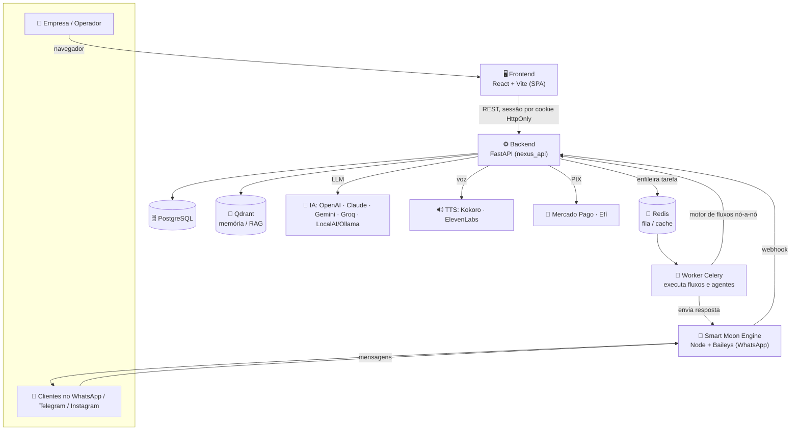

# 🌙 Smart Moon

**Plataforma SaaS multi-empresa de automação e agentes de IA.** Cada empresa cria
seus próprios agentes de inteligência artificial, monta automações visuais que
disparam ações em WhatsApp, Telegram, Instagram e e-mail, e usa módulos prontos de
CRM, voz, marketing, licitações, projetos, financeiro e pagamentos por PIX —
tudo isolado por empresa (*multi-tenant*) e cobrado por planos e créditos.

> Nome interno do motor: **NEXUS.IA**. A descrição da API é literalmente
> *"Plataforma de orquestração de agentes de IA — Motor operacional da Smart Moon"*.

---

## ✨ O que dá para fazer

| Módulo | O que faz para o usuário |
|---|---|
| 🤖 **Agentes de IA** | Cria atendentes/vendedores de IA sob medida — cada um com prompt, personalidade, memória, skills e o modelo/provedor de IA à escolha (OpenAI, Claude, Gemini, Groq ou local). |
| 🔀 **Fluxos (automação visual)** | Desenha automações arrastando nós: recebe uma mensagem, decide com IA e dispara respostas/ações em vários canais — **sem programar**. |
| 💬 **CRM de WhatsApp** | Contatos, etiquetas, funil de vendas (kanban), respostas rápidas, disparos em massa, recepção com fila e passagem do robô para um humano (*handoff*). |
| 🔊 **Voz / TTS** | Dá voz aos agentes: síntese de fala, perfis de voz e clonagem vocal (ElevenLabs, OpenAI, Google, Edge/Kokoro). |
| 📣 **Marketing** | Gera imagens e legendas por IA, publica no Instagram (Meta Graph API), analisa audiência e tem fluxo de aprovação. |
| 📄 **Licitações** | Faz upload de editais em PDF, extrai requisitos/documentos/datas, avalia viabilidade e alerta prazos. |
| 💰 **Pagamentos (PIX)** | Cria cobranças PIX (QR + copia-e-cola) e faz repasses, com Mercado Pago e Efí; carteiras, saques e webhooks. |
| 📊 **Financeiro** | Lança e consulta despesas/receitas conversando com um **Agente Financeiro no WhatsApp**; exporta CSV. |
| 🗂️ **Projetos** | Gerencia projetos coordenados por um agente de WhatsApp, com portal público e relatórios em PDF. |
| 🌟 **Luna** | Assistente que ensina a usar a plataforma com tutoriais em texto, imagem e áudio. |
| 🛒 **Marketplace & Billing** | Lojas de IA, Skills e Agentes; cobrança por **créditos e tokens de IA**; planos free → enterprise. |

---

## 🧭 Como funciona (o fluxo)



**Em palavras:**

1. O **operador** usa o painel React para criar agentes, desenhar fluxos e configurar canais.
2. Um cliente manda mensagem no **WhatsApp** → o **Engine (Baileys)** repassa ao backend por *webhook*.
3. O **backend FastAPI** coloca o trabalho numa fila (Redis) e o **Worker Celery** executa o fluxo.
4. O **motor de fluxos** caminha o grafo nó a nó: consulta a **IA**, lê a **memória** (Qdrant), gera **voz**, cria **PIX** ou chama **APIs externas**, conforme o nó.
5. A resposta volta pelo Engine para o cliente — tudo registrado passo a passo no PostgreSQL.

---

## 🏗️ Arquitetura

O sistema roda inteiramente em containers Docker:

| Serviço | O que é |
|---|---|
| **nexus_api** | API FastAPI (assíncrona, Uvicorn). ~50 grupos de rotas por domínio; núcleo do produto. |
| **nexus_worker** | Worker Celery que executa fluxos, mensagens de canais, webhooks de pagamento e cronjobs. |
| **smartmoon_engine** | Gateway de WhatsApp em Node/TypeScript (Baileys). Fila *anti-ban*, QR por WebSocket, só interno. |
| **postgres** | Banco relacional principal (PostgreSQL 16). Fonte de verdade de empresas, usuários, fluxos, planos. |
| **redis** | Cache + broker do Celery + fila do Engine (bancos 0/1/2/3 separados). |
| **qdrant** | Banco vetorial para RAG e memória dos agentes, isolado por empresa. |
| **localai / ollama** | Modelos de IA locais (API compatível com OpenAI). |
| **kokoro-tts** | Síntese de voz (texto → áudio). |

### Três coisas que o backend faz

- **Motor de fluxos** — lê um fluxo salvo como JSON `{nodes, edges}` e o executa nó a nó; cada tipo de nó (IA, envio de WhatsApp/Telegram/e-mail, PIX, API externa, geração de imagem, espera de evento) tem um *handler* próprio.
- **Agentes treinados** — personas salvas no banco (prompt, modelo, memória, skills) que conversam com clientes e usam *function-calling* para acionar APIs reais.
- **Tarefas de fundo** — Celery + Redis para tudo que é demorado ou agendado, com medição de custo em tokens/USD e débito dos créditos da empresa.

> Toda chamada de LLM passa por um **gateway único** que faz *fallback* entre provedores,
> mede custo e debita os créditos — nunca chama o modelo direto.

---

## 🧱 Stack

- **Backend:** Python 3.12 · FastAPI · SQLAlchemy 2 (async/asyncpg) · Celery · Alembic · Pydantic v2
- **Frontend:** React 18 · Vite 5 · React Router 7 · Zustand · React Flow (editor de fluxos) · Konva (Studio) · Tailwind
- **Engine:** Node 20 · TypeScript · Baileys · Express · WebSocket · BullMQ
- **Dados/infra:** PostgreSQL 16 · Redis 7 · Qdrant · LocalAI/Ollama · Kokoro-TTS · Docker Compose
- **IA:** OpenAI · Anthropic (Claude) · Groq · Gemini · DeepSeek · Mistral · Together · xAI · Ollama/LocalAI
- **Canais & pagamentos:** WhatsApp (Baileys/Cloud API/Z-API) · Telegram · Instagram · Mercado Pago · Efí (PIX)
- **Segurança:** JWT em cookie HttpOnly · 2FA (TOTP) · credenciais cifradas (Fernet) · rate limiting

---

## 📁 Estrutura do repositório

```
smartmoon/
├── nexus-backend/      # API FastAPI + Worker Celery (o motor)
│   └── app/
│       ├── api/routes/ # rotas por domínio (auth, agents, flows, crm, payments, bids…)
│       ├── engine/     # motor de fluxos + handlers de nó
│       ├── services/   # IA (gateway + adapters), memória, billing, campanhas…
│       ├── workers/    # Celery (tasks, beat, crons)
│       ├── models/     # entidades (ORM SQLAlchemy)
│       └── payments/   # gateway PIX (Mercado Pago / Efí)
├── nexus-ia/           # Frontend React + Vite (o painel)
│   └── src/
│       ├── App.jsx     # rotas + menu (NAV_GROUPS) — todos os módulos
│       ├── api.js      # cliente único da API
│       └── pages/      # uma pasta por área do produto
└── smartmoon-engine/   # Gateway de WhatsApp (Node + Baileys)
    └── src/            # instance / manager / api / queue
```

---

## 💳 Planos

A tabela `plans` define 5 planos mensais (BRL) com limites de fluxos, agentes,
skills, integrações, perfis de voz e campanhas (`-1` = ilimitado):

| Plano | Preço | Fluxos | Agentes | Skills | Módulos liberados |
|---|---|---|---|---|---|
| **Free** | R$ 0 | 3 | 1 | 2 | agentes, skills, fluxos |
| **Starter** | R$ 97 | 10 | 3 | 5 | + integrações, voz |
| **Pro** ⭐ | R$ 197 | 30 | 10 | 15 | + agent store, clonagem de voz, marketing |
| **Business** | R$ 497 | 100 | 30 | 50 | + voice agents, campanhas IA |
| **Enterprise** | R$ 997 | ∞ | ∞ | ∞ | + licitações (tudo liberado) |

O que cada usuário enxerga no painel é filtrado pelas *features* do plano, e o
consumo roda sobre um saldo de **créditos** (🪙) e **tokens de IA**.

---

## 🚀 Rodando localmente

Pré-requisitos: **Docker** + **Docker Compose**.

```bash
# 1. Configure os segredos a partir do exemplo
cp nexus-backend/.env.example nexus-backend/.env
# edite nexus-backend/.env com suas chaves (banco, SECRET_KEY, provedores de IA…)

# 2. Suba o backend + banco + serviços de apoio
cd nexus-backend
docker compose -f docker-compose.yml -f docker-compose.prod.yml up -d --build
```

> ⚠️ Este stack **precisa dos dois arquivos compose juntos** (`docker-compose.yml`
> **e** `docker-compose.prod.yml`). A API fica em `http://localhost:8000`
> (`/docs` para a documentação interativa quando `DEBUG=true`).

Frontend (dev):

```bash
cd nexus-ia
npm install
echo 'VITE_API_URL=http://localhost:8000' > .env.development.local
npm run dev   # abre em http://localhost:5173
```

---

## 🔒 Segurança

- Segredos (`.env`, credenciais, chaves) **não** são versionados — veja o `.gitignore`.
- Autenticação por **cookie HttpOnly** (o token nunca vai para o `localStorage`), com 2FA opcional.
- A API **recusa subir** com `SECRET_KEY` fraca; credenciais de provedores são cifradas no banco.
- Isolamento **multi-tenant**: todo dado pertence a uma empresa (`company_id`).

---

*Smart Moon · plataforma de agentes de IA e automação.*
